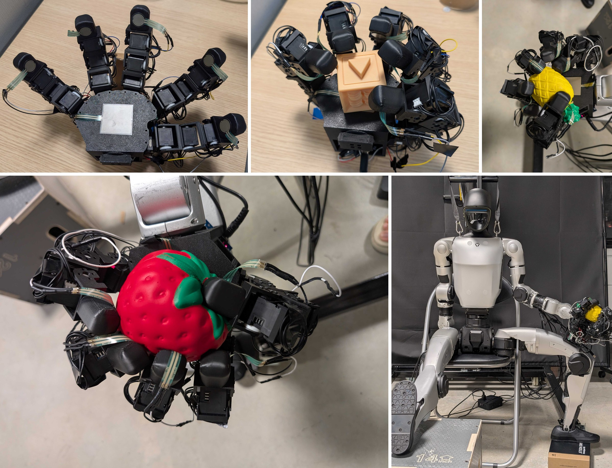

# Tactile Robot Hand



This project shows a simple, cheap way to give a robot hand a sense of touch with off-the-shelf force-sensitive resistors (FSRs). There's one round FSR on each fingertip and one square FSR on the palm. Each sensor feeds a voltage divider built from two 100 kΩ resistors, which makes the hand respond to light touches. An Arduino reads all six channels and streams them over serial.

**Parts**
- 5× [round FSR, Pololu #1696](https://www.pololu.com/product/1696/) (fingertips)
- 1× [square FSR, Pololu #1645](https://www.pololu.com/product/1645) (palm)
- 12× 100 kΩ resistors (2 per sensor)
- 1× Arduino with 6 analog inputs (A0–A5)

## Sensors

| Location | Sensor | Arduino pin |
|---|---|---|
| Index | [round FSR](https://www.pololu.com/product/1696/) | A0 |
| Middle | [round FSR](https://www.pololu.com/product/1696/) | A1 |
| Thumb | [round FSR](https://www.pololu.com/product/1696/) | A2 |
| Palm | [square FSR](https://www.pololu.com/product/1645) | A3 |
| Ring | [round FSR](https://www.pololu.com/product/1696/) | A4 |
| Pinky | [round FSR](https://www.pololu.com/product/1696/) | A5 |

## Circuit


Each sensor is one voltage divider. The FSR runs from 5V to its analog pin, and two 100 kΩ resistors in series (200 kΩ) run from that pin to GND:

```
V_pin = 5V · 200kΩ / (R_FSR + 200kΩ)
```

With no load the FSR is open circuit (≫1 MΩ), so the pin reads about 0. Pressing lowers R_FSR, and the reading rises toward 1023. Using two 100 kΩ resistors (200 kΩ total) instead of the usual ~10 kΩ is what lets the hand feel light touches. Even a small drop in R_FSR produces a clear voltage change. The trade-off is that readings saturate sooner under heavy force.

## Firmware

`firmware/TripleFingerPadTouch/TripleFingerPadTouch.ino` reads A0–A5 and prints one line per sample at 9600 baud, in the order palm, thumb, index, middle, ring, pinky:

```
Palm:0, Thumb:412, Index:0, Middle:388, Ring:0, Pinky:0
```

Upload it with the Arduino IDE, then open the Serial Monitor/Plotter at 9600 baud.

## Regenerating the figures

```bash
pip install pillow schemdraw matplotlib    # in a venv
python tools/make_grid.py ~/Downloads      # folder holding the source photos -> images/photo_grid.jpg
python tools/make_circuit.py               # -> images/circuit.png, images/circuit.svg
```
