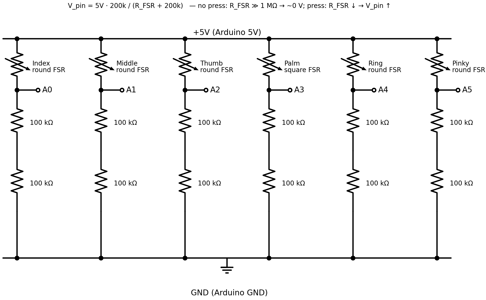

# Tactile Robot Hand


A 5-finger hand with force-sensitive resistors (FSRs): one round FSR on each fingertip and one square FSR on the palm. An Arduino reads all six sensors and streams them over serial.

## Sensors

| Location | Sensor | Arduino pin |
|---|---|---|
| Index | round FSR (Pololu) | A0 |
| Middle | round FSR (Pololu) | A1 |
| Thumb | round FSR (Pololu) | A2 |
| Palm | square FSR | A3 |
| Ring | round FSR (Pololu) | A4 |
| Pinky | round FSR (Pololu) | A5 |

## Circuit



Each sensor is one voltage divider. The FSR runs from 5V to its analog pin, and two 100 kΩ resistors in series (200 kΩ) run from that pin to GND:

```
V_pin = 5V · 200kΩ / (R_FSR + 200kΩ)
```

With no load the FSR is open circuit (≫1 MΩ), so the pin reads about 0. Pressing lowers R_FSR, and the reading rises toward 1023. The large 200 kΩ pull-down makes the sensor respond to light touches but saturate early under heavy force.

## Firmware

`firmware/TripleFingerPadTouch/TripleFingerPadTouch.ino` reads A0–A5 and prints one line per sample at 9600 baud, in the order palm, thumb, index, middle, ring, pinky:

```
Palm:0, Thumb:412, Index:0, Middle:388, Ring:0, Pinky:0
```

Upload it with the Arduino IDE, then open the Serial Monitor/Plotter at 9600 baud.

## Regenerating the figures

```bash
pip install pillow schemdraw matplotlib    # in a venv
python tools/make_grid.py ~/Downloads      # folder holding the source photos -> images/photo_grid.jpg
python tools/make_circuit.py               # -> images/circuit.png, images/circuit.svg
```
